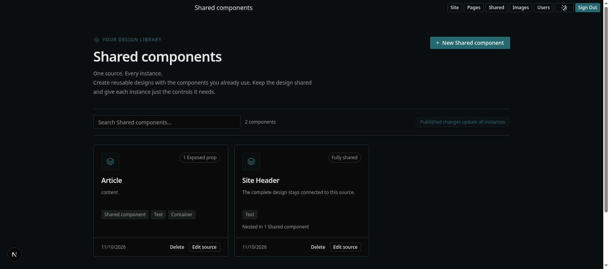
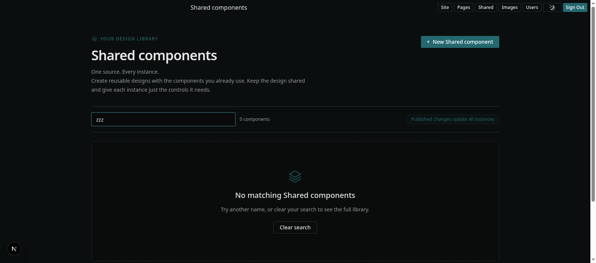
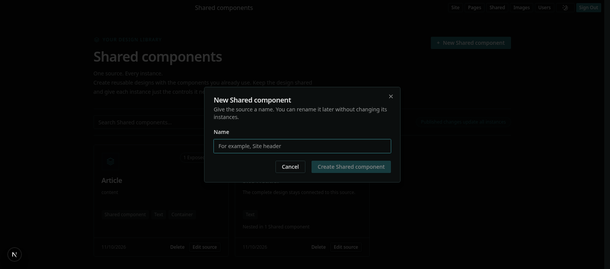
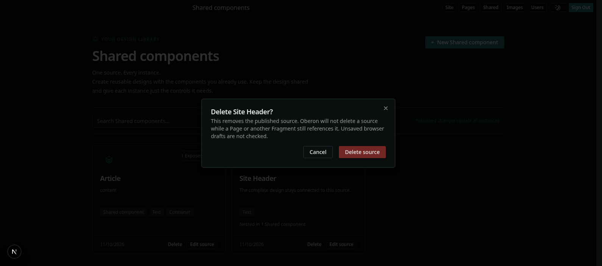
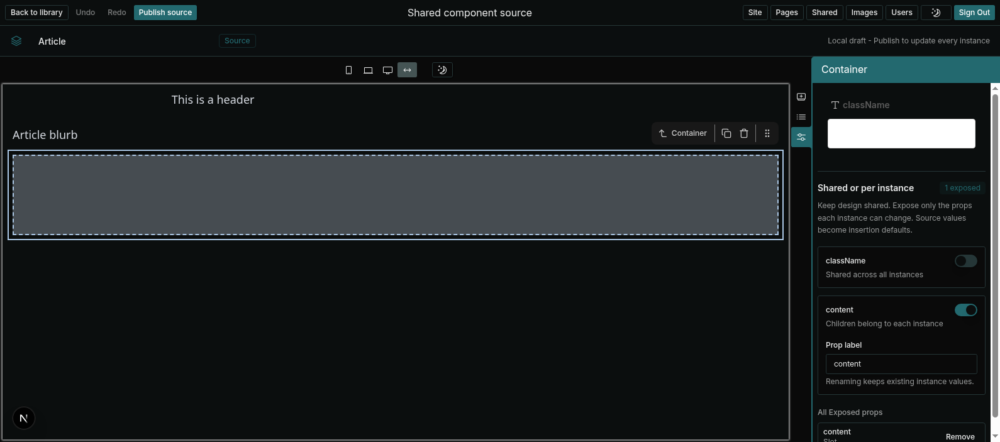
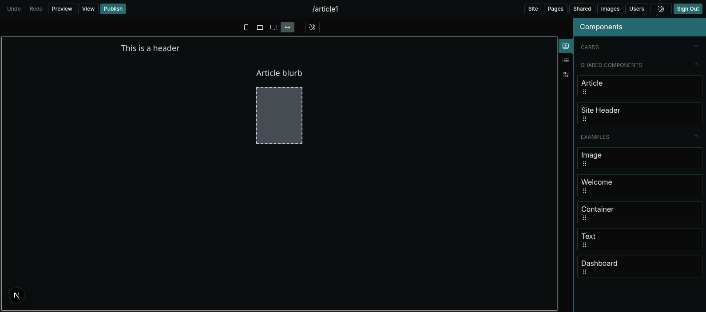
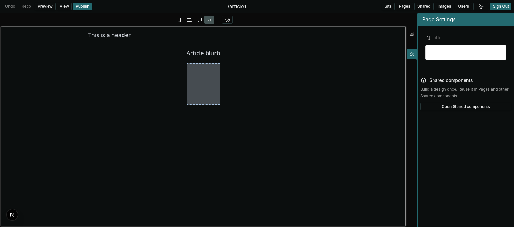
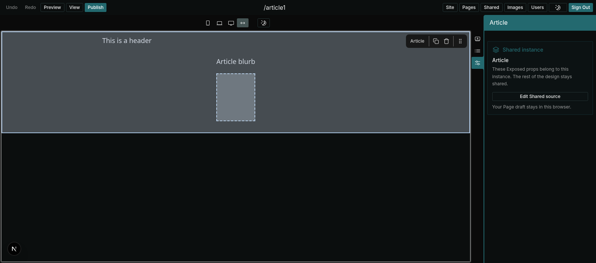
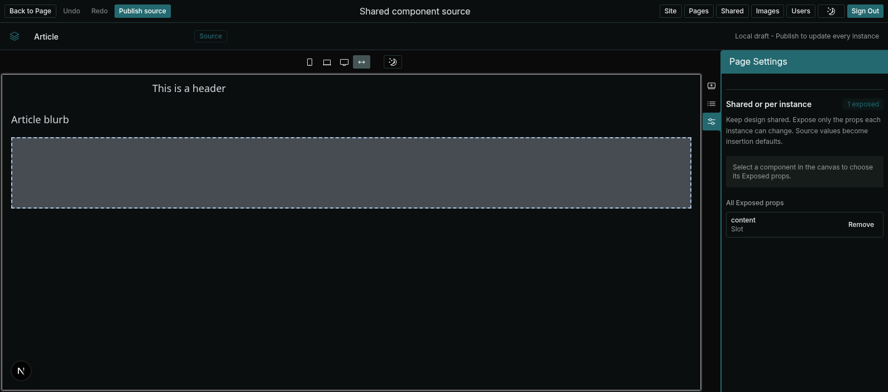

# Shared components UI

Status: agreed UI specification. Build this UI. Visible text, layout, states and flows are the
target. Routes and class names are guidance. See [the plan](shared-components.md) for the rules and
delivery.

The screenshots show the target UI in dark mode. The example data is an `Article` source with an
exposed Container slot and a fully shared `Site Header` source.

## Design language

Use the existing Oberon CMS design language. Add no new tokens or components.

- **Components:** `@tohuhono/ui` Button, Dialog, Input, Label, Switch and toast. Source editing uses
  the same core Page editor, menu bar and Puck sidebar as Pages.
- **Colour:** neutral `card`, `muted` and `border` surfaces. The `primary` colour marks Shared
  content only: the SharedMark icon, the kicker, tinted pills (`border-primary/20 bg-primary/5`) and
  the Shared instance panel. Errors and conflicts use `destructive/10` banners.
- **SharedMark:** a stacked-layers icon. It identifies Shared content in the library cards, the
  empty state, the source name bar and the Shared instance panel.
- **Type:** one `text-3xl`/`md:text-4xl` page heading, `text-lg` card titles and `text-xs` muted
  helper text. Helper text states ownership in one short sentence.
- **Shapes:** `rounded-lg` cards, `rounded-full` status pills, `rounded` component chips and
  bordered Switch rows.
- **Vocabulary:** use the [CONTEXT.md](../CONTEXT.md) terms in visible text: Shared component,
  source, instance and Exposed prop. Every ownership state names its owner: "Shared across all
  instances", "Editable on each instance" or "Children belong to each instance".

## Navigation and routes

| Surface              | Route                                        | Entry points                          |
| -------------------- | -------------------------------------------- | ------------------------------------- |
| Library              | `/cms/library`                               | The "Shared" menu link                |
| Source editor        | `/cms/library?source=<id>`                   | Card title, "Edit source"             |
| Source from a Page   | `/cms/library?source=<id>&returnTo=<editor>` | "Edit Shared source" in a Page editor |
| Page editor (insert) | `/cms/edit/<path>`                           | The "Shared components" palette group |

The "Shared" link sits between "Pages" and "Images" in the CMS menu. The source editor returns to
the library or, with `returnTo`, to the Page editor that opened it. Other routes are acceptable if
the entry points and return flow stay the same.

## Library

The library is the home of all Shared components. It answers three questions: what exists, what each
instance can change, and where each source is used.

From top to bottom:

1. **Header.** The kicker "Your design library" with SharedMark, the heading "Shared components" and
   the subtitle "One source. Every instance." A primary "+ New Shared component" button sits on the
   right.
2. **Toolbar.** A search field ("Search Shared components..."), a live count ("2 components") and
   the pill "Published changes update all instances".
3. **Card grid.** One card for each Shared component:
   - SharedMark and an ownership badge: "N Exposed props" or "Fully shared".
   - The name, as a link to the source editor.
   - The Exposed prop labels joined with " / ". A fully shared card says "The complete design stays
     connected to this source."
   - Up to four chips for the component types in the source. An empty source says "An empty canvas,
     ready for your design".
   - "Nested in N Shared components" when other sources use it.
   - The last update date, "Delete" and "Edit source". Readers without write permission see "View
     source" and no "Delete".
4. **Explainer.** Three numbered steps: "Author the source", "Choose Exposed props" and "Publish
   once".

### Search and empty states

Search filters by name. With no match, the grid becomes a dashed panel with "No matching Shared
components" and a "Clear search" button.

With no Shared components, the panel says "Start with something worth sharing". It suggests a Site
header, a call to action or an Article layout, and offers the create button to writers.

### Create

"+ New Shared component" opens a dialog. It asks only for a name. The placeholder is "For example,
Site header". "Create Shared component" stays disabled until the name has text. On create, the
source editor opens.

### Delete

"Delete" opens a confirmation dialog. It warns that Oberon does not delete a source while a Page or
another Shared component references it, and that browser drafts are not checked. When a reference
blocks deletion, the dialog shows the error in an alert and keeps the source.

## Source editor

The source editor is the normal Puck editor with Shared chrome. Authors use the same registered
components as in Pages, including other Shared components.

- **Menu bar.** "Back to library" (or "Back to Page"), Undo, Redo and the primary "Publish source".
  The centre title is "Shared component source".
- **Name bar.** SharedMark, an inline name field, a "Source" pill and the note "Local draft -
  Publish to update every instance". Renaming keeps the identity, so instances stay connected.
- **Canvas.** The authored tree, with ordinary Puck selection, drag and drop and slots.
- **Conflict banner.** When the source changed elsewhere, a destructive banner says so and offers
  "Reload source". Publish is disabled until the author reloads.
- **Read-only.** Readers without write permission see the rendered source, a muted banner "Read-only
  source. Ask an author with Pages write permission to make changes." and "Back to library".

### Exposure panel

The exposure panel sits under the Puck fields in the right sidebar. Its heading is "Shared or per
instance", with a count pill ("1 exposed"). The explainer says: "Keep design shared. Expose only the
props each instance can change. Source values become insertion defaults."

- With nothing selected, the panel asks the author to select a component.
- For the selected component, each eligible prop has a bordered row with a Switch ("Expose X") and a
  state line:
  - "Shared across all instances" when off.
  - "Editable on each instance" for an exposed value.
  - "Children belong to each instance" for an exposed slot.
- An exposed row shows a "Prop label" field. The helper text says "Renaming keeps existing instance
  values."
- "All Exposed props" lists every exposure in the source with its label, field kind and a "Remove"
  button. Remove makes that prop shared again.

## Page editor

### Insert

The Components palette has a "Shared components" group. It lists every published Shared component by
name. Authors drag them into the canvas like any other component.

With nothing Shared selected, the sidebar shows an "Open Shared components" card. It says "Build a
design once. Reuse it in Pages and other Shared components." and links to the library.

### Shared instance panel

When an instance is selected, the Puck fields show only its Exposed props. The "Shared instance"
panel names the source and says "These Exposed props belong to this instance. The rest of the design
stays shared." "Edit Shared source" opens the source with `returnTo`. The note "Your Page draft
stays in this browser." tells the author that leaving does not lose Page work.

An exposed slot shows as an ordinary empty Puck drop zone inside the instance. Authors drop
components into it, and those children belong to that instance only.

### Edit source from a Page

"Edit Shared source" opens the source editor with "Back to Page" in place of "Back to library".
After "Publish source", "Back to Page" returns to the same Page editor, and the instance shows the
published change.

## Examples

### Article with an exposed body

1. In the library, select "+ New Shared component" and name it `Article`.
2. Add a header Text, a blurb Text and an empty Container.
3. Select the empty Container. In the exposure panel, turn on "Expose content". The state becomes
   "Children belong to each instance". Set the Prop label to `Body`.
4. Select "Publish source". The library card shows "1 Exposed prop" and `Body`.
5. In a Page, drag `Article` from "Shared components". Drop Text into the empty Body slot.
6. A later change to the header Text in the source reaches every Article instance. Each instance
   keeps its own Body children.

### Site header with nested navigation

1. Create `Main navigation` and publish it with no exposures. Its card shows "Fully shared".
2. Create `Site header`. Drag `Main navigation` from "Shared components" into it, then publish.
3. The `Main navigation` card shows "Nested in 1 Shared component". Delete stays blocked while
   `Site header` references it.
4. A change to `Main navigation` reaches every Page that uses `Site header`.

### Editable call to action

1. Create `Call to action` with a Text for the headline and a styled Container.
2. Select the Text and turn on "Expose text". The state becomes "Editable on each instance". Set the
   label to `Headline`.
3. Publish. Each Page instance gets the source headline as its default, and authors can change it
   per instance. The styling stays shared.
